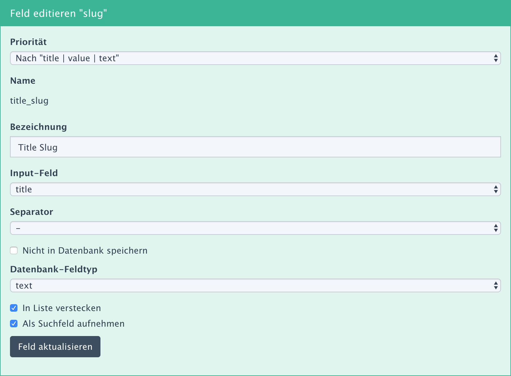
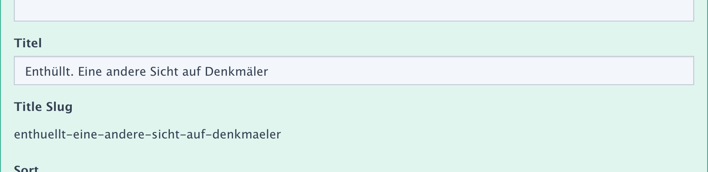

YForm Erweiterung: Slug
=============

* YForm Erweiterung zur Erzeugung eines Slugs (Clean URL) aus dem Wert eines anderen Feldes.

Installation
-------

* Paket herunterladen oder über den Installer installieren

Changelog
-------

### Version 1.0.0 // 14.04.2020 

* Initial release

Credits
-------

* Slug Generator https://github.com/ausi/slug-generator
